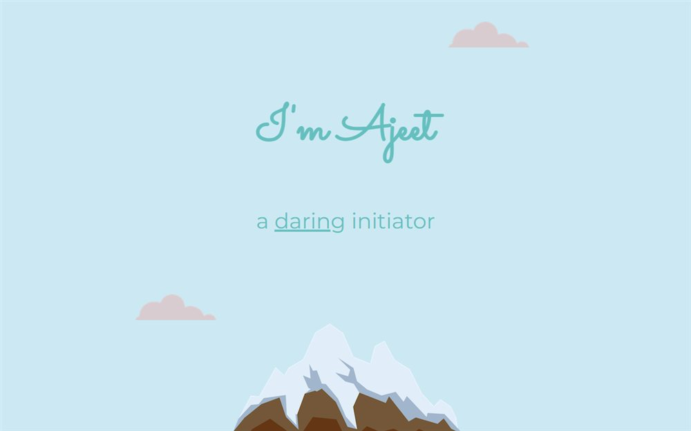

# basic_info921

**[Open the live site](https://ajeet-iitk.github.io/basic_info921/)**

## What it is

A one-page personal profile: who I am, what I study, and the handful of things I keep coming back to - books, clouds, digital art and mountains. Each block is a short note with an image, laid out as a simple scrolling page.

## Features

- Single static page, no framework
- Section images for the interests I care about
- Custom favicon
- Works offline once saved

## Run locally

Open `index.html` in a browser, or use the hosted copy:

<https://ajeet-iitk.github.io/basic_info921/>

## Files

| File | Purpose |
| --- | --- |
| `index.html` | The profile page |
| `Ajeet-modified.png` | Portrait |
| `books.png`, `cloud.png`, `digital-art.png`, `mountain.png` | Section artwork |
| `favicon.ico` | Site icon |
